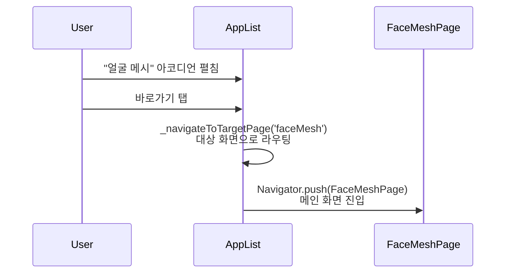
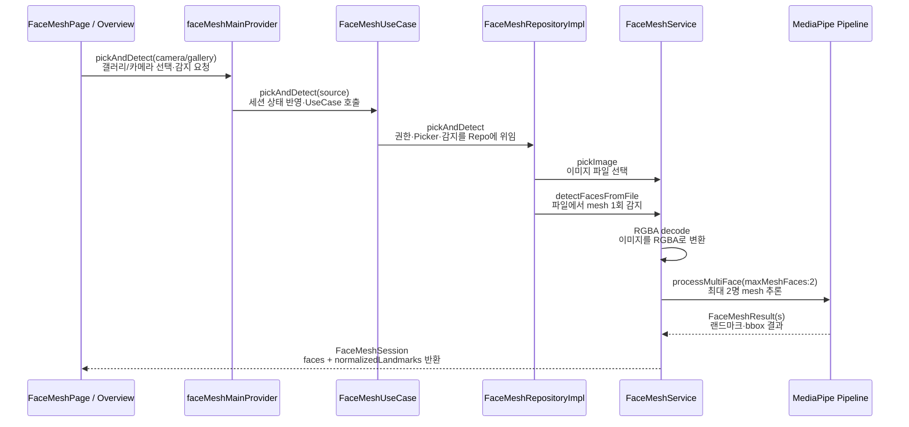
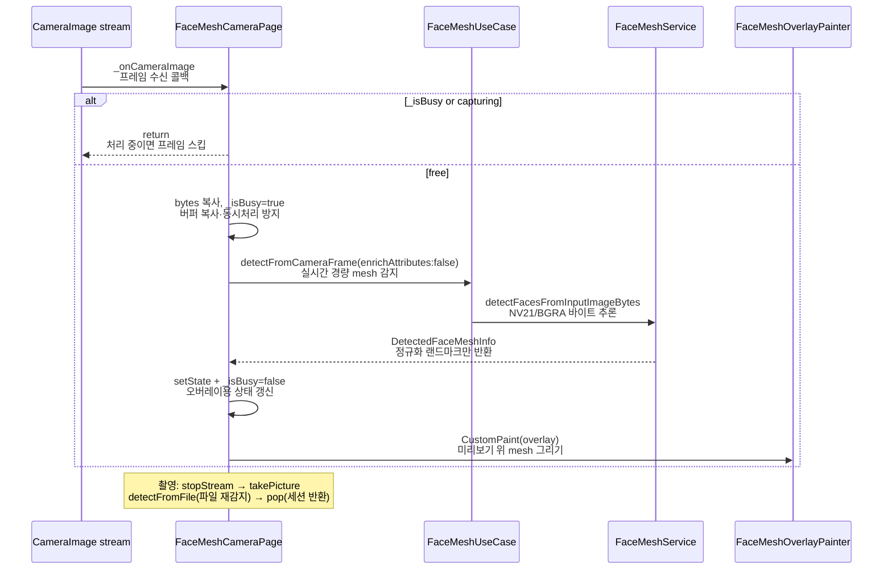
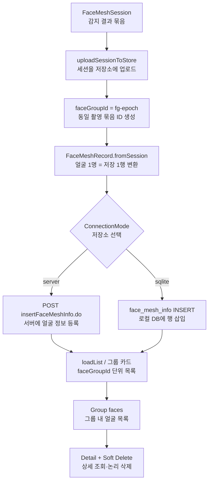

# Face Mesh (얼굴 메시) 개발자 가이드

## 1. 기능 개요

### 1.1 무엇을 하는 앱인가

| 구분 | 내용 |
|------|------|
| 목적 | 얼굴 **표면 기하(랜드마크 메시)** 를 온디바이스로 검출·시각화·저장 |
| 엔진 | MediaPipe Face Mesh (iris 활성 시 최대 **478**점, 기본 표면 **468**점) |
| 감지 위치 | **항상 로컬** (네트워크 불필요) |
| 저장 | 서버(`/fms`) 또는 SQLite (`face_mesh_info`) 선택 |
| 표시 | 랜드마크 개수·점수·앵커·머리 각도. 전체 landmark JSON은 저장하지 않음 |

### 1.2 사용자 시나리오

1. 앱 목록 → **얼굴 메시 (Face Mesh)** 진입  
2. **인식 경로 3가지** 중 하나로 mesh 확인 (아래 1.3 참고)  
3. 연결 카드에서 서버/SQLite 선택  
4. 정보 저장 → 목록 → 그룹 → 상세 → 삭제  

### 1.3 인식 경로 3가지 (샘플 선택 가이드)

이 앱은 **프레임워크 샘플**이므로,  **개발자가 필요한 기능을 선택** 하여 사용할 수 있습니다.

#### 메인 화면 CTA 구조

| UI | 동작 |
|----|------|
| **이미지로 인식** | 하단/다이얼로그에서 **갤러리** 또는 **카메라(스냅샷)** 선택 |
| **실시간 카메라** | 앱 내 미리보기에서 프레임마다 mesh 표시 → 촬영 시 세션 확정 |

즉 개발자 관점의 인식 경로는 아래 **3가지**입니다.

#### 경로별 차이
|구분 | 경로 | 입력 | 추론 시점 | 결과 |
|---|------|------|-----------|------|
| 1 | 이미지로 인식 → **갤러리** | 앨범에서 고른 정지 이미지 | 선택 직후 **1회** | `FaceMeshSession` → 메인 Overview |
| 2 | 이미지로 인식 → **카메라** | 시스템 카메라 앱으로 찍은 **사진 1장** | 촬영·반환 직후 **1회** | 동일 |
| 3 | **실시간 카메라** | `CameraController` 미리보기 스트림 | 프레임마다(busy 시 스킵) + 촬영 시 파일로 **재감지** | 라이브 오버레이 → 촬영 후 세션 pop |

**이미지→카메라**와 **실시간 카메라**는 둘 다 “카메라”이지만 목적이 다릅니다.

| 비교 | 이미지로 인식 → 카메라 | 실시간 카메라 |
|------|------------------------|---------------|
| API | `image_picker` (`ImageSource.camera`) | `camera` 패키지 + MediaPipe 연속 추론 |
| 사용자 체감 | OS 카메라 UI로 찍고, 돌아온 뒤 mesh 확인 | 미리보기 위에서 mesh가 **따라 움직임** |
| MediaPipe 부하 | 단발 (저부하) | 연속 (발열·배터리·ImageReader 이슈 가능) |
| 샘플로서의 의미 | “정지 이미지 파이프라인” 데모 | “라이브 오버레이 파이프라인” 데모 |
| mesh 핵심 가치 | 사진 품질·시스템 카메라 기능 활용 | Face Mesh의 실시간 기하 시각화 |

촬영 확정 단계에서 실시간 경로도 파일 기반 재감지를 하므로, “찍은 뒤의 저장용 세션” 자체는 경로 1·2와 같은 `FaceMeshSession` 모델로 통일됩니다. 차이는 **그 전까지의 입력·체험·기술 스택**입니다.

#### 코드에서 어디에 연결되는가

| 경로 | UI 진입 | 호출 흐름 |
|------|---------|-----------|
| 갤러리 / 이미지→카메라 | `FaceMeshOverview` → `onPickImageTap` → 소스 선택 → `FaceMeshMain.pickAndDetect` | UseCase `pickAndDetect` → Service `pickImage` + `detectFacesFromFile` |
| 실시간 | `FaceMeshOverview` → `onLiveCameraTap` → `FaceMeshCameraPage` | 프레임: `detectFromCameraFrame(enrichAttributes: false)` / 촬영: `detectFromFile` 후 `Navigator.pop(session)` |

### 1.4 실행 환경 요약

```bash
cd flutter_deviceapi_19_edit/device-api-app
flutter pub get
# Riverpod codegen이 필요하면:
dart run build_runner build --delete-conflicting-outputs
flutter run
```

| 항목 | 값 |
|------|-----|
| 이 저장소 | `flutter_deviceapi_19_edit` (Device API 샘플. 얼굴은 Face Mesh, AI 채팅 포함) |
| 표시 이름 | `Device API` (AndroidManifest / iOS CFBundleDisplayName) |
| Android `applicationId` | `egovframework.mobile_deviceapi` |
| `minSdk` | **24** (MediaPipe 요구) |
| AGP / Kotlin | 8.9.1 / 2.3.10 |
| iOS Bundle | `egovframework.mobile-deviceapi` |

---

## 2. 전체 아키텍처

```
┌─────────────────────────────────────────────────────────────┐
│ Presentation (screens/faceMesh)                             │
│  View ← Riverpod Notifier(Controller) ← State               │
└───────────────────────────┬─────────────────────────────────┘
                            │ UseCase Provider
┌───────────────────────────▼─────────────────────────────────┐
│ Domain                                                      │
│  Entities / FaceMeshRepository(interface) / FaceMeshUseCase │
└───────────────────────────┬─────────────────────────────────┘
                            │ Repository Impl (Facade)
┌───────────────────────────▼─────────────────────────────────┐
│ Data                                                        │
│  FaceMeshService (MediaPipe + HTTP)                         │
│  FaceMeshSqliteService                                      │
│  Remote / Sqlite Repository Impl                            │
└─────────────────────────────────────────────────────────────┘
```

**핵심 규칙 (Facade)**

- **감지(detect)** → 항상 `FaceMeshService` (로컬 MediaPipe)  
- **저장/조회/삭제(persist)** → `FaceMeshConnectionMode`에 따라 Remote 또는 SQLite  

---

## 3. 디렉터리·파일 맵

```
device-api-app/
├── data/
│   ├── app_list_data.json          # 앱 목록 항목 (targetPage: faceMesh)
│   ├── feature_data.json           # 기능 가이드 문구
│   └── sql/face_mesh_info.db
├── lib/
│   ├── config/
│   │   ├── app_config.dart         # /fms, face_mesh_info
│   │   └── face_mesh_sqlite_schema.dart
│   ├── di/
│   │   ├── providers.dart          # Service/Repo/UseCase wiring
│   │   └── face_mesh_connection_provider.dart
│   ├── domain/faceMesh/
│   │   ├── entities/               # Session, Record, Result, ...
│   │   ├── repositories/face_mesh_repository.dart
│   │   └── usecases/face_mesh_usecase.dart
│   ├── data/faceMesh/
│   │   ├── datasources/
│   │   │   ├── face_mesh_service.dart
│   │   │   ├── face_mesh_sqlite_service.dart
│   │   │   └── faceMeshServerConnectionService.dart
│   │   └── repositories/
│   │       ├── face_mesh_repository_impl.dart      # Facade
│   │       ├── face_mesh_remote_repository_impl.dart
│   │       └── face_mesh_sqlite_repository_impl.dart
│   ├── presentation/
│   │   ├── widgets/app_list.dart   # 바로가기 case 'faceMesh'
│   │   ├── widgets/app_navigation.dart
│   │   └── screens/faceMesh/
│   │       ├── state/
│   │       ├── view_model/
│   │       ├── view/
│   │       └── widgets/
│   └── l10n/message_keys/face_mesh_message_keys.dart
└── docs/applications/face_mesh.md  # 본 문서
```

---

## 4. 기능 실행 흐름

### 4.1 앱 목록 → 메인 진입



관련 코드:

- `data/app_list_data.json` → `"targetPage": "faceMesh"`
- `lib/presentation/widgets/app_list.dart` → `case 'faceMesh': ... FaceMeshPage()`
- `lib/presentation/widgets/app_navigation.dart` → FeatureShell 내 앱 전환용 동일 매핑

### 4.2 이미지 선택 감지



- 권한: `FaceMeshPermissionUtil` (camera / photos)  
- 결과 UI: `FaceMeshOverview` 가 이미지 + `FaceMeshOverlayPainter` 표시  

### 4.3 실시간 카메라 mesh



**설계 포인트**

| 이슈 | 대응 |
|------|------|
| ImageReader 버퍼 부족 로그 | plane bytes **즉시 복사**, `_isBusy` 게이트로 동시 처리 1개 제한 |
| mesh 좌표 어긋남 | 오버레이를 `CameraPreview(child:)` **내부**에 배치 |
| ±90° 회전 | **오버레이 rotation = 0** (추론 rotation과 이중 보정 방지) |
| 갤럭시 하단 네비 겹침 | `bottom: 24 + MediaQuery.viewPadding.bottom` |
| 실시간 성능 | `enrichAttributes: false` → head pose(geometry) 생략 |


### 4.4 저장 → 목록 → 상세



---

## 5. Domain Layer 상세

### 5.1 `DetectedFaceMeshInfo` / `FaceMeshSession`

경로: `lib/domain/faceMesh/entities/face_mesh_info.dart`

| 필드 | 설명 |
|------|------|
| `boundingBox` | 픽셀 bbox (추론 이미지 기준) |
| `landmarks` | 픽셀 landmark (저장/정적 미리보기용, 실시간에선 비울 수 있음) |
| `normalizedLandmarks` | **0~1** 정규화 좌표 (실시간 오버레이 권장) |
| `landmarkCount` | `mesh.landmarks.length` (468 또는 478) |
| `hasIris` | landmark 478 이상(또는 iris 인덱스 존재) |
| `score` | MediaPipe confidence |
| `trackingId` | multi-face track id |
| `noseTipNorm` 등 | AR 확장용 정규화 앵커(코끝/눈/입) |
| `interocularDistanceNorm` | 양안 거리(정규화) — 스케일 기준 |
| `headEulerX/Y/Z` | `estimateGeometry().headPose` (pitch/yaw/roll, enrich 시) |

`FaceMeshSession`은 한 번의 감지 결과 묶음입니다. `source`는 `'camera'` | `'gallery'`.

### 5.2 `FaceMeshRecord`

경로: `lib/domain/faceMesh/entities/face_mesh_record.dart`

- **저장 단위**: 얼굴 1명 = DB/서버 1행  
- **그룹 키**: `faceGroupId` (동일 세션의 여러 얼굴 묶음)  
- JSON/SQLite 키는 camelCase + snake + UPPER 별칭을 `JsonRead`로 수용  
- `landmarkCount`, `meshScore`, `hasIris`, `iodNorm`, 앵커 좌표(`noseTip`/`leftEye`/`rightEye`/`mouthCenter`) 저장  
- 전체 landmark JSON은 용량 이슈로 **미저장** (개수·키포인트만)  
- UI는 Detection식 미소/눈개방 대신 **mesh 기하·앵커**를 주 표시

주요 메서드:

- `fromSession` / `fromSessionFace` — 세션 → 레코드 리스트  
- `toUploadFields()` — HTTP form body  
- `toSqliteRow()` — SQLite insert map  

### 5.3 Result sealed classes

경로: `lib/domain/faceMesh/entities/face_mesh_result.dart`

UI는 `switch (result)` 패턴으로 Success/Empty/Failure를 분기합니다.  
메시지 문자열은 `FaceMeshMessageKeys`이고, 화면 문구는 `l10n.faceMesh*`입니다.

### 5.4 Connection / Group / UUID

| 파일 | 역할 |
|------|------|
| `face_mesh_connection_mode.dart` | `server` \| `sqlite` + `sqliteDbFileName` |
| `face_mesh_data_source_status.dart` | 연결 UI 상태 enum |
| `face_mesh_group.dart` | 목록 카드용 `FaceMeshGroupSummary.fromRecords` |
| `face_mesh_uuid_guard.dart` | 디바이스 uuid 소유권·유효성 |

### 5.5 Repository / UseCase

**Interface** `face_mesh_repository.dart`

```text
pickAndDetect / detectFromFile / detectFromInputImageBytes
uploadFaceMeshInfo / getFaceMeshList / deleteFaceMeshInfo
```

**UseCase** `face_mesh_usecase.dart`

| 메서드 | 역할 |
|--------|------|
| `pickAndDetect` | 권한·피커·감지는 Repo |
| `detectFromFile` | 파일 경로 감지 |
| `detectFromCameraFrame` | 실시간 바이트 감지 |
| `uploadSessionToStore` | uuid + faceGroupId + 다건 upload |
| `loadList` | 디바이스 uuid 기준 목록 |
| `deleteItems` | 소유권 검사 후 Soft Delete |

---

## 6. Data Layer 상세

### 6.1 `FaceMeshService` (핵심)

경로: `lib/data/faceMesh/datasources/face_mesh_service.dart`

#### 초기화 (lazy)

```text
FaceDetectorProcessor (maxResults: 2, CPU)
  + FaceMeshProcessor.createForMultiFace(enableIris: true, CPU)
  + FaceMeshInferencePipeline
```

- DI에서 `ref.onDispose(service.close)`로 네이티브 리소스 해제  
- `enableIris: true` → landmark 478 가능

#### 파일 감지

1. 이미지 디코드 → RGBA `FaceMeshImage`  
2. `pipeline.processMultiFace(maxMeshFaces: 2)`  
3. `_mapMeshResult` (기본 `enrichAttributes: true`)

#### 카메라 프레임 감지

| 플랫폼 | 입력 |
|--------|------|
| Android | `FaceMeshNv21Image.tryFromSinglePlane` → `processNv21MultiFace` |
| iOS | BGRA `FaceMeshImage` → `processMultiFace` |

- **반드시** `Uint8List.fromList(bytes)`로 plane 버퍼 복사  
- `enrichAttributes: false`(실시간): normalized landmark + count/score/trackId/앵커만  
- `enrichAttributes: true`(파일/촬영 확정): + head pose(geometry)  

#### HTTP API (`/fms`)

| Method | Path | 비고 |
|--------|------|------|
| POST | `/insertFaceMeshInfo.do` | form fields |
| GET | `/selectFaceMeshInfoList.do?uuid=` | `faceMeshInfoList` |
| DELETE | `/deleteFaceMeshInfo.do?sn=&uuid=` | Soft Delete |

### 6.2 Facade Repository

경로: `lib/data/faceMesh/repositories/face_mesh_repository_impl.dart`

```dart
// 의사코드
detect*  → _service (항상 로컬)
upload/list/delete → _useSqlite ? _sqlite : _remote
```

### 6.3 Remote / SQLite Impl

| 파일 | 역할 |
|------|------|
| `face_mesh_remote_repository_impl.dart` | HTTP 호출만 |
| `face_mesh_sqlite_repository_impl.dart` | connection의 db 파일명 + SqliteService |
| `face_mesh_sqlite_service.dart` | `FeatureTableService` + 스키마 검증 |
| `face_mesh_server_connection_service.dart` | 목록 API에 기기 uuid를 붙여 서버 연결을 확인 |

### 6.4 SQLite 스키마

- SQLite DB: `data/sql/face_mesh_info.db`  
- 서버 스키마: `device-api-web/script/mysql/ddl/deviceapi_all_create_mysql.sql`  
- Dart: `lib/config/face_mesh_sqlite_schema.dart`  
- 필수 컬럼: `faceGroupId`, `useYn`  
- 앱에서 DB import 시 `face_mesh_info` 테이블 포함 DB 선택  

---

## 7. Presentation Layer 상세

### 7.1 화면

| 클래스 | 파일 | 역할 |
|--------|------|------|
| `FaceMeshPage` | `face_mesh_main.dart` | 메인: Overview + 연결카드 + 저장/목록 |
| `FaceMeshCameraPage` | `face_mesh_camera_page.dart` | 실시간 mesh + 촬영 |
| `FaceMeshListPage` | `face_mesh_list.dart` | faceGroupId 카드 목록·다중 삭제 |
| `FaceMeshGroupFacesPage` | `face_mesh_group_faces.dart` | 그룹 내 얼굴 목록 |
| `FaceMeshDetailedPage` | `face_mesh_detailed.dart` | 단건 상세·삭제 |
| `FaceMeshFunctionPage` | `face_mesh_description.dart` | FeatureShell 가이드 |

### 7.2 State / ViewModel (Riverpod)

| Provider | 파일 | 역할 |
|----------|------|------|
| `faceMeshMainProvider` | `face_mesh_controller.dart` | 세션·처리 중·업로드 |
| `faceMeshListProvider` | 동일 | 목록·선택·배치 삭제 |
| `faceMeshDetailProvider(sn)` | 동일 | 상세 삭제 |
| `faceMeshConnectionStatusProvider` | `face_mesh_connection_status_controller.dart` | 연결 스냅샷 |

State 정의: `state/face_mesh_state.dart`

### 7.3 주요 위젯

| 위젯 | 역할 |
|------|------|
| `FaceMeshOverview` | 이미지 선택/실시간 CTA + 결과 오버레이 |
| `FaceMeshOverlayPainter` | landmark points / wire / boxOnly |
| `FaceMeshConnectionStatusCard` | 서버·SQLite 토글 UI |
| `FaceMeshConnectionResolver` | 연결 보장(서버 체크, DB import/선택) |
| `FaceMeshPermissionUtil` | 카메라·갤러리 권한 |
| `FaceMeshTrackingPreview` / `GroupTrackingPreview` | 목록·상세 bbox 미리보기 |

### 7.4 `FaceMeshOverlayPainter` 좌표 규칙

경로: `widgets/face_painter.dart`

1. `normalizedLandmarks`가 있으면 우선 사용  
2. `rotationDegrees`에 따라 정규화 좌표 변환 (0/90/180/270)  
3. `mirrorHorizontal`이면 `x = 1 - x` (Android 전면)  
4. 캔버스에 **균등 스케일** (`x * width`, `y * height`) — 가로·세로 다른 비율 스케일 금지  

**실시간 카메라에서의 실제 설정**

- `rotationDegrees: 0` (`_overlayRotationDegrees`)  
- `mirrorHorizontal: !iOS && front`  
- painter는 `CameraPreview`의 **child**로 붙어 미리보기와 동일 좌표계 공유  

### 7.5 카메라 페이지 레이아웃

```text
Stack(expand)
 ├─ FittedBox(cover) + SizedBox(previewDisplaySize)
 │    └─ CameraPreview(
 │         child: CustomPaint(FaceMeshOverlayPainter)
 │       )
 ├─ 상단 얼굴 수 배너
 └─ 하단 안내 + 촬영 버튼 (viewPadding.bottom 반영)
```

---

## 8. DI 배선

### 8.1 Connection

`lib/di/face_mesh_connection_provider.dart`

- `faceMeshConnectionProvider` — mode / db 파일명  
- `faceMeshSqliteServiceProvider` — 스키마 바인딩  

### 8.2 Core (providers.dart)

```text
faceMeshServiceProvider
  → FaceMeshService (onDispose close)

faceMeshRepositoryProvider
  → FaceMeshRepositoryImpl(
       service, remote, sqlite, readConnection)

faceMeshUseCaseProvider
  → FaceMeshUseCase(repository)
```

`ApiFeature.faceMesh`는 `api_feature_shell_config.dart`에 등록되어 FeatureShell 공통 UI와 연결됩니다. 화면 문구는 [국제화 (l10n)](../presentation/12_l10n.md)의 `faceMesh*` 키를 쓴다.

---

## 9. 설정·플랫폼

### 9.1 `AppConfig`

```dart
faceMeshEndpoint = '/fms'
faceMeshTableName = 'face_mesh_info'
getFaceMeshUrl(path) // currentBaseUrl + endpoint + path
```

### 9.2 Android

| 항목 | 위치 | 값 |
|------|------|-----|
| label | AndroidManifest / Info.plist | Device API |
| applicationId | app/build.gradle.kts | egovframework.mobile_deviceapi |
| minSdk | 동일 | 24 |
| AGP | settings.gradle.kts | 8.9.1 |
| Kotlin | 동일 | 2.3.10 |
| google-services | android/app/google-services.json | `egovframework.mobile_deviceapi` 클라이언트 포함 |

### 9.3 권한

- Android: `CAMERA`, 미디어/저장소 관련  
- iOS: `NSCameraUsageDescription`, Photo Library 사용 설명  

---

## 10. 구현 메모

| 항목 | 내용 |
|------|------|
| 패키지 | `mediapipe_face_mesh` |
| Endpoint | `/fms` |
| 테이블 | `face_mesh_info` (`landmarkCount` 포함) |
| 실시간 enrich | 끔 (속도). 파일·촬영 확정만 enrich |
| 오버레이 | `CameraPreview.child`, 회전 **0 고정** |
| 하단 여백 | `viewPadding.bottom` |
| max faces | pipeline 2 |
| 메시지 | `FaceMeshMessageKeys`, `l10n.faceMesh*` |

구성은 Clean Architecture, Facade(detect는 로컬 / 저장은 서버·SQLite 분기), faceGroupId 그룹 목록, Soft Delete, FeatureShell + 연결 카드입니다.

---

## 11. 알려진 이슈·주의사항

### 11.1 `ImageReader_JNI ... maxImages buffers`

- **원인**: 카메라 프레임 속도 > MediaPipe 처리 속도  
- **현재 완화**: bytes 복사, `_isBusy` 스킵, 실시간 enrich 생략  
- **기능**: 보통 크래시 없이 일부 프레임만 드롭. 로그는 남을 수 있음  
- **추가 완화안**: ResolutionPreset.low, 처리 주기 throttle(100~150ms)

### 11.2 서버 API

- `/fms` 백엔드가 없으면 **SQLite 모드**로 저장/목록 테스트  
- 목록·등록·삭제는 uuid 기준 CRUD이고, 저장 행에 `landmarkCount`가 있습니다  
- 연결 확인은 `GET /fms/selectFaceMeshInfoList.do`에 기기 uuid를 붙입니다. uuid가 없으면 서버가 400을 반환하고, 앱은 연결 실패로 표시합니다. 공통 규칙은 [DeviceApiClient](../architecture/9_device_api_client.md)를 본다.

---

## 13. 파일별 상세 카탈로그

### 13.1 Domain — entities

| 파일 | 클래스/타입 | 기능 |
|------|-------------|------|
| `face_mesh_info.dart` | `DetectedFaceMeshInfo` | mesh 결과(bbox, landmarks, landmarkCount, score, iris, 앵커, iod, headEuler, trackingId) |
| 동일 | `FaceMeshSession` | 한 번의 감지 묶음(`imagePath`, `imageSize`, `faces`, `detectedAt`, `source`). `hasFaces`, `copyWith` 제공 |
| `face_mesh_record.dart` | `FaceMeshRecord` | 영속화 DTO. `fromSession`/`fromSessionFace`, `fromJson`, `toUploadFields`, `toSqliteRow` |
| `face_mesh_result.dart` | sealed Result들 | Pick / Process / Upload / ListLoad / DeleteBatch 성공·실패·빈결과. UI `switch` 분기용 |
| `face_mesh_connection_mode.dart` | `FaceMeshConnectionMode`, `FaceMeshConnectionState` | `server`\|`sqlite` + SQLite DB 파일명 |
| `face_mesh_data_source_status.dart` | `FaceMeshDataSourceStatus` | 연결 카드 상태(connected / disconnected / checking 등) |
| `face_mesh_group.dart` | `FaceMeshGroupSummary` | 목록 카드용. `fromRecords`로 faceGroupId별 집계 |
| `face_mesh_uuid_guard.dart` | 함수들 | 디바이스 uuid 유효성·레코드 소유권 검사 |

### 13.2 Domain — repository / usecase

| 파일 | 기능 |
|------|------|
| `face_mesh_repository.dart` | 추상 포트: detect 계열 + upload/list/delete |
| `face_mesh_usecase.dart` | Presentation이 호출하는 애플리케이션 서비스. uuid 발급, faceGroupId 생성(`fg-{epoch}`), 다건 upload 루프, list/delete 오케스트레이션 |

**UseCase 메서드 요약**

| 메서드 | 입력 | 출력/부작용 |
|--------|------|-------------|
| `getDeviceUuid` | — | 디바이스 uuid 문자열 |
| `pickAndDetect` | `ImageSource` | `FaceMeshPickResult` |
| `detectFromFile` | 경로, source | `FaceMeshProcessResult` |
| `detectFromCameraFrame` | NV21/BGRA bytes + meta, `enrichAttributes` | `List<DetectedFaceMeshInfo>` |
| `uploadSessionToStore` | `FaceMeshSession` | 레코드 생성 후 순차 upload |
| `loadList` | — | uuid 기준 목록 Result |
| `deleteItems` | sn 목록 | Soft Delete 배치 Result |

### 13.3 Data — datasources

| 파일 | 클래스 | 핵심 메서드 / 역할 |
|------|--------|-------------------|
| `face_mesh_service.dart` | `FaceMeshService` | `_initProcessors`, `pickImage`, `detectFacesFromFile`, `detectFacesFromInputImageBytes`, `close`, HTTP static CRUD |
| 동일 | `_RgbaImage` | 파일 디코드 결과 버퍼 |
| `face_mesh_sqlite_service.dart` | `FaceMeshSqliteService` | `FeatureTableService` 래핑. insert/select/softDelete, 스키마 검증 |
| `face_mesh_server_connection_service.dart` | `FaceMeshServerConnectionService` | 목록 API에 기기 uuid를 붙여 서버 연결을 확인 |

**`FaceMeshService` 메서드 흐름**

1. `_ensureReady()` → detector + mesh(iris) + pipeline  
2. 파일: RGBA decode → `processMultiFace` → `_mapMeshResult`(enrich 기본 true)  
3. 카메라: Android NV21 / iOS BGRA → `processNv21MultiFace` 또는 `processMultiFace` → enrich 옵션  
4. HTTP: `postFaceMeshInfo` / `getFaceMeshInfoList` / `deleteFaceMeshInfo`

### 13.4 Data — repositories

| 파일 | 역할 |
|------|------|
| `face_mesh_repository_impl.dart` | **Facade**. detect→Service, persist→mode에 따라 remote/sqlite |
| `face_mesh_remote_repository_impl.dart` | `FaceMeshService` HTTP만 호출. Record ↔ form/json 변환 |
| `face_mesh_sqlite_repository_impl.dart` | connection의 db 파일로 SqliteService CRUD |

### 13.5 Presentation — state / view_model

| 파일 | Provider / State | 역할 |
|------|------------------|------|
| `state/face_mesh_state.dart` | `FaceMeshMainState` | uuid, session, isProcessing, error |
| 동일 | `FaceMeshListState` | list, selection, loading |
| 동일 | `FaceMeshDetailState` | 단건 삭제 처리 상태 |
| `view_model/face_mesh_controller.dart` | `faceMeshMainProvider` | pick/applySession/clear/upload |
| 동일 | `faceMeshListProvider` | reload / toggleSelect / deleteSelected |
| 동일 | `faceMeshDetailProvider` | deleteOne |
| `view_model/face_mesh_connection_status_controller.dart` | `faceMeshConnectionStatusProvider` | 연결 스냅샷 갱신 |
| `*.g.dart` | codegen | `riverpod_annotation` 생성물 — 수동 편집 금지 |

### 13.6 Presentation — view

| 파일 | 화면 | 사용자 액션 → 다음 |
|------|------|-------------------|
| `face_mesh_main.dart` | 메인 | Overview 감지 → 연결카드 → 저장 → 목록 이동 |
| `face_mesh_camera_page.dart` | 실시간 | stream 감지 → 촬영 → `Navigator.pop(FaceMeshSession)` |
| `face_mesh_list.dart` | 그룹 목록 | 카드 탭 → GroupFaces / 다중 삭제 |
| `face_mesh_group_faces.dart` | 그룹 얼굴 | 타일 → Detailed |
| `face_mesh_detailed.dart` | 상세 | 속성 표 + Soft Delete |
| `face_mesh_description.dart` | FeatureShell 가이드 | 기능 설명 전용 (감지/저장 없음) |

### 13.7 Presentation — widgets

| 파일 | 위젯 | 역할 |
|------|------|------|
| `face_mesh_overview.dart` | `FaceMeshOverview` | 카메라/갤러리/실시간 CTA + 결과 섹션 |
| `face_painter.dart` | `FaceMeshOverlayPainter` | points/wireApprox/boxOnly 렌더 |
| `face_coordinates_translator.dart` | 좌표 유틸 | (필요 시) 이미지↔뷰 변환 보조 |
| `face_mesh_permission_util.dart` | 정적 유틸 | camera / photos 권한 요청 |
| `face_mesh_connection_status_card.dart` | 연결 카드 UI | 서버/SQLite 선택·상태 표시 |
| `face_mesh_connection_resolver.dart` | Resolver | 저장 전 연결 보장(서버 체크, DB import) |
| `face_mesh_tracking_preview.dart` | 단건 bbox 미리보기 | 상세 화면 |
| `face_mesh_group_tracking_preview.dart` | 그룹 전체 bbox | 그룹 화면 |

### 13.8 Config / DI / 데이터 / 진입점

| 파일 | 역할 |
|------|------|
| `config/app_config.dart` | `/fms`, `face_mesh_info`, `getFaceMeshUrl` |
| `config/face_mesh_sqlite_schema.dart` | 필수/옵션 컬럼 정의 |
| `data/sql/face_mesh_info.db` | SQLite DB (앱 import용) |
| `data/app_list_data.json` | `"targetPage": "faceMesh"` |
| `data/feature_data.json` | FeatureShell 문구 |
| `di/face_mesh_connection_provider.dart` | connection + sqlite service provider |
| `di/providers.dart` | `faceMeshService` / `Repository` / `UseCase` |
| `presentation/widgets/app_list.dart` | `case 'faceMesh'` → `FaceMeshPage` |
| `presentation/widgets/app_navigation.dart` | FeatureShell 앱 전환 매핑 |
| `l10n/message_keys/face_mesh_message_keys.dart` | 메시지 키 상수 |

### 13.9 카메라 페이지 내부 상태 필드 (개발자용)

`face_mesh_camera_page.dart`의 `_FaceMeshCameraPageState` 핵심 필드:

| 필드 | 의미 |
|------|------|
| `_controller` | `CameraController` |
| `_isBusy` | MediaPipe 처리 중이면 프레임 스킵 |
| `_isCapturing` | 촬영 중 스트림 중단 |
| `_faces` | 최신 감지 결과 (오버레이용) |
| `_imageRotation` | 추론에 넘기는 sensor orientation |
| `_overlayRotationDegrees` | **항상 0** (이중 보정 방지) |
| `_previewSize` | 카메라 해상도 (FittedBox 기준) |

프레임 처리 의사코드:

```text
_onCameraImage(image):
  if (_isBusy || _isCapturing) return
  _isBusy = true
  frame = copyPlanes(image)          // ImageReader 버퍼 즉시 반환
  faces = useCase.detectFromCameraFrame(..., enrichAttributes: false)
  setState(_faces = faces)
  _isBusy = false
```

---

## 14. 빠른 코드 인덱스

| 보고 싶은 것 | 파일 |
|--------------|------|
| MediaPipe 호출 | `data/faceMesh/datasources/face_mesh_service.dart` |
| 저장 오케스트레이션 | `domain/faceMesh/usecases/face_mesh_usecase.dart` |
| 서버/SQLite 분기 | `data/faceMesh/repositories/face_mesh_repository_impl.dart` |
| 실시간 UI | `presentation/screens/faceMesh/view/face_mesh_camera_page.dart` |
| mesh 그리기 | `presentation/screens/faceMesh/widgets/face_painter.dart` |
| 메인 화면 | `presentation/screens/faceMesh/view/face_mesh_main.dart` |
| DI | `di/providers.dart`, `di/face_mesh_connection_provider.dart` |
| 앱 목록 진입 | `presentation/widgets/app_list.dart` + `data/app_list_data.json` |
| SQLite DB | `data/sql/face_mesh_info.db` |

---

## 15. 참고

- MediaPipe Face Landmarker / Face Mesh: Google AI Edge 문서  
- 패키지: [mediapipe_face_mesh](https://pub.dev/packages/mediapipe_face_mesh)  
- 앱 안내: `device-api-app/README.md`
