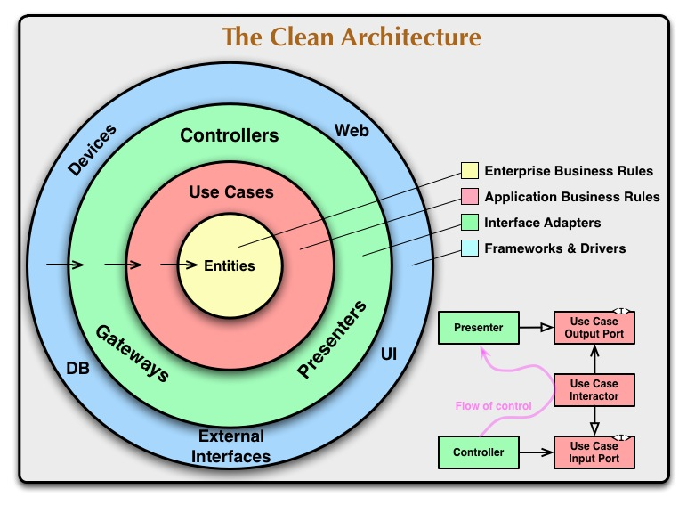
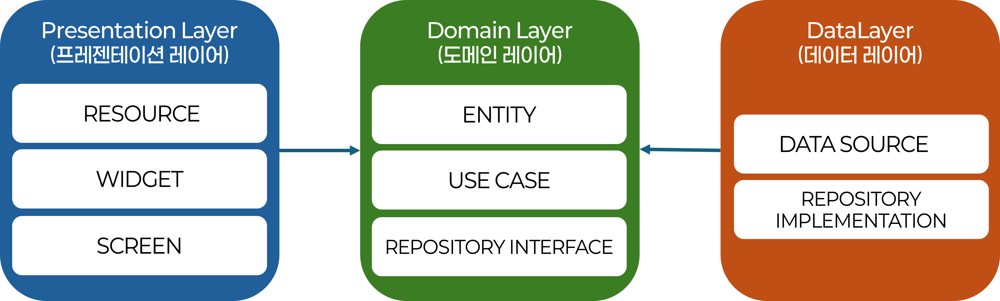

# Clean Architecture 가이드

> **이 가이드는 본 프로젝트에 적용된 Clean Architecture 패턴을 설명합니다.**

## Clean Architecture란?

Clean Architecture는 로버트 C. 마틴(Robert C. Martin)이 제안한 소프트웨어 아키텍처 패턴으로, **의존성 역전 원칙(Dependency Inversion Principle)**을 중심으로 설계된 아키텍처입니다.

> [Clean Architecture- Robert C. Martin](https://blog.cleancoder.com/uncle-bob/2012/08/13/the-clean-architecture.html)

### 핵심 개념

Clean Architecture는 소프트웨어를 **동심원 구조**로 구성하며, 각 레이어는 명확한 책임을 가지고 있습니다. 
    

### 주요 특징

1. **의존성 방향**: 외부 레이어는 내부 레이어에 의존하지만, 내부 레이어는 외부 레이어에 의존하지 않음
2. **비즈니스 로직 독립성**: Domain 레이어는 프레임워크나 외부 라이브러리에 의존하지 않음
3. **테스트 용이성**: 각 레이어를 독립적으로 테스트 가능
4. **유지보수성**: 변경 사항이 다른 레이어에 영향을 최소화

### 프로젝트의 Clean Architecture 구조

1. **Domain 레이어는 순수 Dart 코드**: 외부 의존성 없이 비즈니스 로직에 집중
2. **의존성 방향**: Presentation → Domain ← Data
3. **인터페이스 기반 설계**: Repository 인터페이스를 통한 느슨한 결합
4. **Use Case 중심**: 비즈니스 로직을 Use Case로 명확히 분리
5. **의존성 주입**: Riverpod을 통한 런타임 의존성 관리
6. **Feature-first 폴더 구성**: `domain/`·`data/`·`presentation/screens`를 기능(app) 단위로 물리 분리

## MVVM이 아닌 Clean Architecture 적용 이유

### 1. **복잡한 데이터 소스 관리**

이 프로젝트는 다양한 데이터 소스를 다룹니다:

- **로컬 데이터**: 디바이스 정보, GPS, 파일, SQLite
- **서버 API**: device-api-web REST (기능별 `/xxx`). AI 채팅은 웹이 ai-rag를 중계
- **플랫폼 API**: Android/iOS 네이티브 기능 (센서, 카메라, FCM 등)

Clean Architecture를 통해 각 데이터 소스를 독립적으로 관리하고, 필요 시 쉽게 교체할 수 있습니다.

### 2. **다양한 기능 모듈**

앱 목록에는 **19개 기능**(가속도계부터 SQLite Manager까지, AI 채팅 포함)이 있습니다. 각 모듈이 동일한 아키텍처 패턴을 따릅니다. 목록은 [device_applications.md](../device_applications.md) 를 보면 됩니다.

### 3. **테스트 가능성**

Domain 레이어가 외부 의존성 없이 순수 Dart 코드로 작성되어 있어, 단위 테스트 작성이 용이합니다.

### 4. **의존성 관리**

Riverpod을 사용한 의존성 주입을 통해:

- 런타임에 의존성 교체 가능 (`ProviderScope` override)
- Mock 객체 주입으로 테스트 용이
- `keepAlive` Provider로 UseCase·Repository 수명 관리

## 가이드 목차

### 1. [프로젝트 구조](./1_project_structure.md)
- 프로젝트 디렉토리 구조
- 각 레이어의 역할과 위치
- 모듈별 구조 예시

### 2. [레이어 구조](./2_layers.md)
- Presentation Layer 상세 설명
- Domain Layer 상세 설명
- Data Layer 상세 설명
- 레이어 간 의존성 규칙

### 3. [의존성 역전 원칙](./3_dependency_inversion.md)
- 의존성 방향과 흐름
- 의존성 역전의 구현
- 단계별 설명

### 4. [실제 코드 예시](./4_examples.md)
- Device Info 기능 전체 예시
- 각 레이어별 코드 설명
- 실제 프로젝트 코드 기반

### 5. [의존성 주입](./5_dependency_injection.md)
- Riverpod을 사용한 의존성 주입
- `di/providers.dart` · feature `*_connection_provider.dart`
- 실제 사용 예시

### 6. [에러 처리](./6_error_handling.md)
- 통합 에러 핸들러
- 에러 타입별 처리
- 실제 사용 예시

### 7. [Entity·State 작성 규칙](./7_entity_conventions.md)
- freezed 없이 유지하는 직렬화·파싱 컨벤션
- `JsonRead`, `toUploadFields` / `toSqliteRow` / `toJson`
- Presentation state `copyWith` 규칙

### 8. [Riverpod 화면 상태](./8_riverpod.md)
- UseCase Provider와 화면 Notifier의 자리
- AI 채팅 `aiServerConnected` (`null` / `true` / `false`)
- `updateAiServerConnection`과 `ref.mounted`

### 9. [DeviceApiClient](./9_device_api_client.md)
- device-api-web 공통 HTTP (`get` / `post` / `delete` / `probe`)
- 연결 확인은 HTTP 상태만 보고, 목록 본문은 버린다
- 목록 API가 uuid 없이 400이면 연결 확인에도 기기 uuid를 붙인다
- AI 서버(`selectAiRagConnection.do`)는 `probe`로 보지 않는다

### 10. [기기 UUID](./10_device_uuid.md)
- 보안 저장소 `device_install_id`의 UUID v4
- 목록·등록·삭제가 uuid를 요구하는 API와, 파일 다운로드가 fileSn과 uuid를 함께 받는 경로
- `*_uuid_guard.dart` 소유권 검사

### 11. [서버와 SQLite 전환](./11_server_sqlite_connection.md)
- 연결 모드, 상태 카드, Resolver
- 목록 버튼에서 같은 SELECT가 두 번 나가는 이유
- AI 채팅은 질의와 AI 서버 확인이 모드와 따로 동작

### 12. [새 기능 등록](./12_new_feature.md)
- `targetPage`를 맞출 파일
- 서버 패키지·mapper·Swagger
- l10n·`build_runner` 체크리스트

### 13. [Presentation UX/UI 가이드](../presentation/0_index.md)
- 화면 Depth(0~6)로 나눈 Flutter 위젯 사용법
- 초보자용 레시피·치트시트
- 색상·텍스트 리소스
- [Flutter 활용 보완](../presentation/11_flutter_practices.md)
- [국제화 (l10n)](../presentation/12_l10n.md)