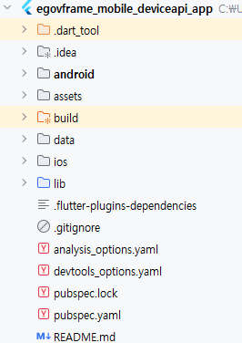
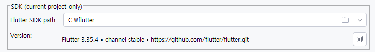
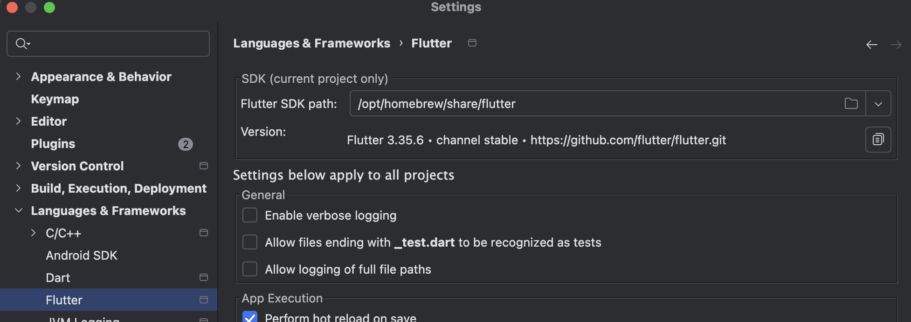
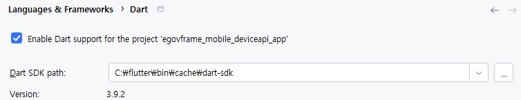
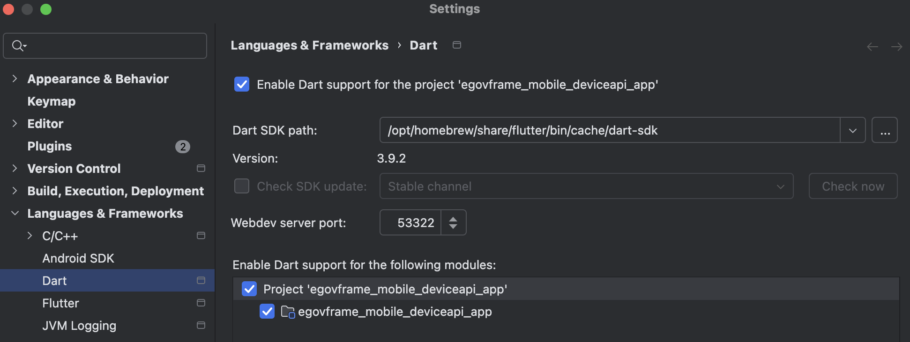
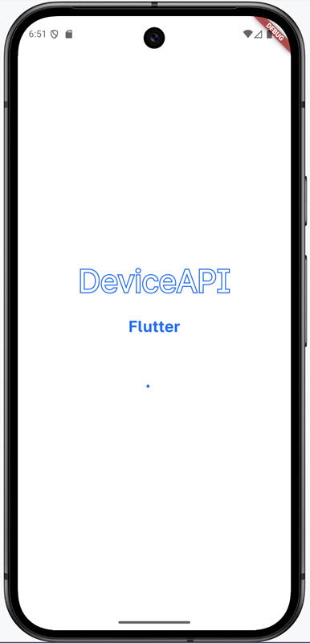
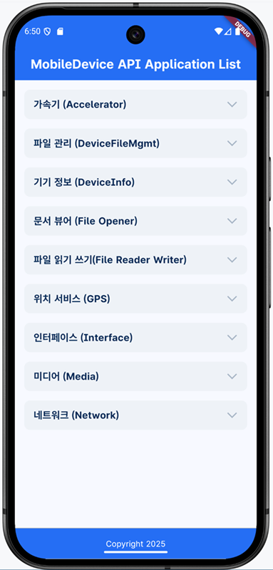

# Flutter 기반 DeviceAPI 프로젝트 시작하기

## 1. 프로젝트 실행

- 메인화면에서 Open > 모바일 프로젝트(egovframe-mobile-deviceapi-app) 선택 후 Open
- Android SDK가 설치되어있는 경우 프로젝트의 아이콘이 Android로 표시</br>
  

## 2. Flutter 설정 확인

프로젝트 실행 후 프로젝트의 영역이 Flutter가 아닌 Android나 일반 프로젝트 형태로 Build 되어 있는 경우 Flutter 및 Dart 설정에 대한 확인이 필요함

### 1) Flutter 프로젝트 확인



- 프로젝트 좌측에 Flutter 아이콘이 있는지 확인
- data , lib, pubspec.yaml 등 flutter 관련 파일이 존재하는지 확인
- Flutter 프로젝트가 아닌 경우 2,3번 문제 확인

### 2) Flutter / Dart 경로 확인

- 메뉴바에서 File > Settings > Language & FrameWorks > Flutter 또는 Dart

#### Flutter

- [Settings 1.Flutter 설치](/settings.md)에서 지정한 경로에 Flutter가 지정되어있는지 확인
  - Window
    
  - macOS
    

#### Dart

- Window
  
- macOS
  
  - Enable Dart support for the following modules 내부 프로젝트 체크 표시
  - macOS의 경우 추가 설정 [Dart SDK is not specified](/settings.md#2-dart-sdk-is-not-specified) 참조

## 3. 라이브러리 확인

### pubspec.yaml

- `pubspec.yaml` 파일에 사용하고있는 flutter API 확인</br>
  각 사용하고 있는 API에 대한 설명은 [모바일 아키텍처](https://www.egovframe.go.kr/home/sub.do?menuNo=98) 하단의 오픈소스 사용현황에서 확인 가능
- 기능별 패키지는 [device_applications.md](./device_applications.md) 참고

- pubspec에 정의된 라이브러리 호출 후 코드 생성
  ```ps1
  flutter clean
  flutter pub get
  flutter gen-l10n
  dart run build_runner build --delete-conflicting-outputs
  ```
    *프로젝트 Open시 Build를 진행하지만 라이브러리를 불러오지 못해 에러표시가 생기는 경우 실행

## 4. Device 기동
Device Manager 에서 Device 기동</br>
*[Android Studio Emulator 설치 및 설정](/emulator.md#2-안드로이드-애뮬레이터-설치) 참고

## 5. Flutter 실행
Emulator(Virtual Device) 를 미리 실행시켜 두어야 목록에서 확인 가능

### 방법 1) 상단 메뉴바에서 실행
</br>
- Select Box에서 실행 가능한 Device 선택
- 상단의 '▷' 버튼을 눌러 Flutter 실행

### 방법 2) 명령어로 실행
- 실행가능한 디바이스 검색
    ```ps1
    flutter devices
    ```
    =실행결과
    ```ps1
    Found 4 connected devices:
    sdk gphone16k x86 64 (mobile) • emulator-5554 • android-x64    • Android 16 (API 36) (emulator)
    # 현재 OS 및 설치되어있는 브라우저가 목록에 표시 (Windows, Chrome 등)
    ```
    emulator-5554가 DeviceID이므로 복사

- 명령어로 실행
    ```ps1
    # flutter run -d <DeviceID>
    flutter run -d emulator-5554
    ```
- 종료시키는 경우엔 터미널에서 Ctrl + C 

## 6. 실행 완료 화면
- 초기 시작시 Loading 화면</br>
    *applist 화면이 로딩되면 페이지전환 </br>
    

- DeviceAPI Application 목록 화면 (가속도계 ~ SQLite Manager, **AI 채팅** 포함 19개)</br>
    

## 7. WebServer와 연동
연동 서버를 열지 않아도 Flutter 앱은 기동 가능</br>
서버와 앱을 local 또는 운영으로 나눠 실행하는 절차는 [local과 운영 실행](/run_profiles.md)을 따른다.

- local 서버: `application.properties` 기본값으로 기동
- 운영 서버: 같은 파일의 `[DEV/운영]` 주석 항목을 수정한 뒤 기동
- local 앱은 `flutter run`만 하면 `lib/config/app_config.dart`의 `apiHost` `defaultValue`와 포트 `9700`으로 접속한다.
- 개발 PC 주소가 다르면 그 `defaultValue`를 수정한다. 한 번만 바꿀 때는 `--dart-define=API_HOST`로 덮어쓴다. Android 에뮬레이터에서 개발 PC는 `10.0.2.2`이다.
- 운영 앱은 `--dart-define=APP_ENV=dev`와 `API_BASE_URL`, `API_USERNAME`, `API_PASSWORD`를 넘긴다.

AI 채팅은 앱이 9700만 호출하고, RAG 주소는 `application.properties`에만 둔다.

## 연관 가이드

- [Flutter 설치가이드](/settings.md)
- [Android Studio Emulator 설치 및 설정](/emulator.md)
- [DeviceAPI 연동 WebServer 기동](/webserver.md)
- [local과 운영 실행](/run_profiles.md)